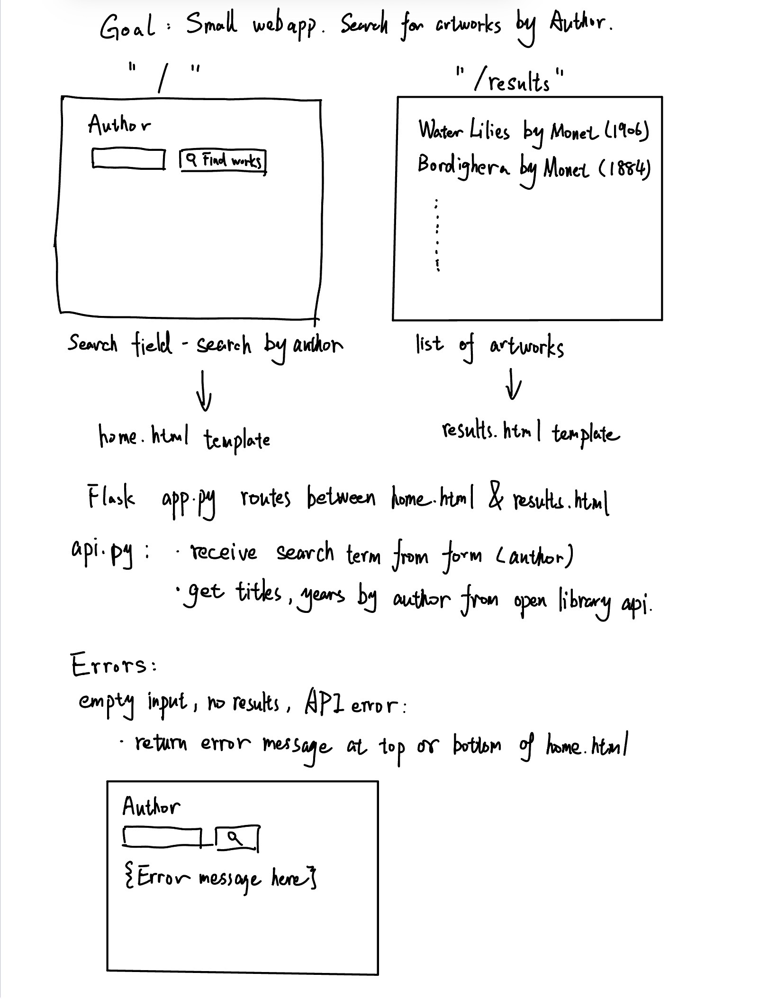
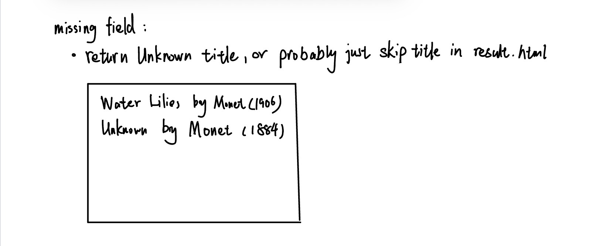

# HW4 Plan

## 1. Sketch

Search page:

Results page:

## 2. Data I need

Fields from the API response that the results page uses:

| Field | What it's for | If it's missing |
|---|---|---|
| title |present the title of artwork| show "Unknown" |
| artist_title | present the artist's name next to the title | show "Unknown artist" |
| date_display | presnet the artwork's date or date range | show "Date Unknown" |

## 3. Spec for each piece

### `search_art(term)` in api.py
In: A search term as a string, such as "Monet"
Out: The artwork list from the API response's data field, with up to 10 results. Each result may include 'id', 'title', 'artist_title' and 'date_display'.
Checks:
  1. A successful response with valid JSON returns the data list
  2. A network error, request timeout, or non-200 response returns 'None'

### Route `/`
In: Get a request to '/'
Out: Render 'home.html' with an Author input and a "Find Artist" button.
Checks:
  1. Opening '/' displays the search form without an error message.
  2. Entering "monet" and submitting the form sends the browsers to result page.

### Route `/results`
In: A get request containing the searching term. If the searching term is missing, use an empty string.
Out: Render 'results.html' if the query returns a valid artwork details. Display each artwork's title, artist, and date.
Checks:
  1. A successful search displays the submitted name in the heading and the returned artworks in a list. Missing artist names display "Unknown artist", empty date strings display "Date unknown"
  2. A missing or empty 'author_search' displays "Please enter an author name and try again." without calling 'search_art'.
  3. Need to verify different error responses: Missing or empty fields display "Unknown" for the title, "Unknown artist" for the artist, and "Date Unknown" for the date.

## 4. Check results

The following checks were run during the Codex review on November 3, 2026.
Browser checks used the live app. Simulated API checks used Flask's test client
with controlled responses, so they are not browser checks.

| Check | Pass / Fail | Notes |
|---|---|---|
| Home page | Pass | Search form displays correctly. |
| Valid search | Pass | Shows artwork titles, artists, and dates. |
| Empty input | Pass | Shows a message without calling the API. |
| No results | Pass | Shows the no-results message. |
| API failure | Pass | Returns None and shows an error message. |
| Missing fields | Pass | Shows "Unknown", "Unknown artist", or "Date Unknown". |
